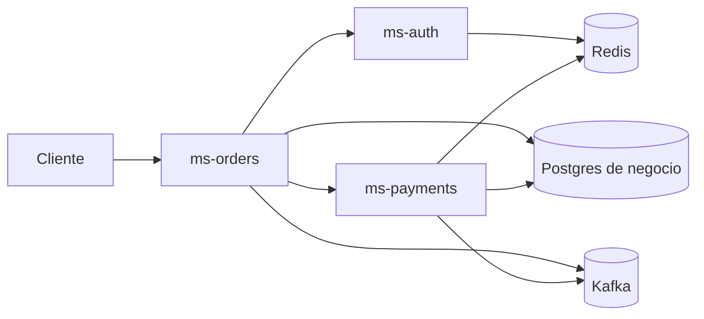
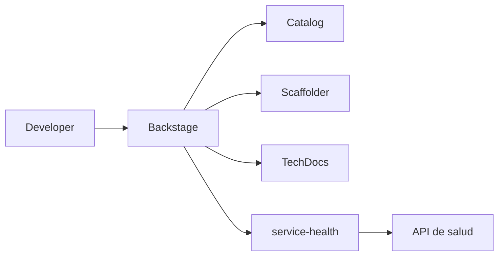

# Arquitectura del proyecto

Tiempo estimado: 15 min
Nivel: Intermedio
Importancia para entrevista: CRÍTICO
Prioridad: ALTO

## 1. Objetivo

Tener un solo dibujo de ACME, el de negocio y el del portal, sin flechas de más.

## 2. Prerrequisitos

Proyecto final.

## 3. Concepto

Dos planos. No los juntes en una caja "plataforma".

Plano de negocio, que Backstage no ejecuta:

Plano del portal:

Postgres del portal no aparece en el primer dibujo. Kafka no aparece en el segundo, salvo como Resource dentro del catálogo.

## 4. ¿Por qué existe?

El diagrama del enunciado del curso mete Backstage encima de los Nest. Sirve de contexto. En la entrevista, si lo dejas así, parece que el checkout pasa por el portal. Este capítulo lo parte.

## 5. Arquitectura

La de arriba. Es la que dibujas en la pizarra.

## 6. Ejemplo real

`ms-orders` está en los dos planos: como proceso en el primero, como Component en el segundo. Son el mismo nombre y no el mismo proceso.

## 7. Laboratorio

Dibuja los dos planos en papel, de memoria. Luego abre este fichero y corrige.

Resultado esperado: el cliente no tiene flecha hacia Backstage. El developer no tiene flecha hacia Kafka, salvo que digas "mira el Resource en la ficha".

## 8. Validación

Alguien que no leyó el curso entiende, con tu dibujo, que la tienda sigue si el portal cae.

## 9. Troubleshooting

### Una sola caja "ACME platform"

Pártela. Si no, te van a preguntar dónde corre el `POST /v1/orders` y vas a señalar el portal.

### Flecha de Backstage a Postgres de pedidos

Eso sería un plugin leyendo la base de negocio. No lo construiste y no lo quieres. El Resource solo declara la dependencia.

## 10. Ejercicio

Añade en el papel el CI, al lado del repo, no dentro del portal. Una caja "Actions".

## 11. Preguntas de entrevista

### ¿Dónde corre un pedido?

Respuesta corta: en `ms-orders`. El portal solo dice quién es el dueño y qué contrato tiene.

Explicación: Nest, su base, Kafka. Backstage no está en ese request.

Qué mencionar: los dos planos.

## 12. Conexión con arquitectura

- Microservicios: plano uno.
- Platform Engineering: plano dos.
- DevOps: Actions al lado del repo.
- CI/CD: no dentro del request de compra.
- Cloud: cada plano puede vivir en el mismo cluster y en distinto namespace.
- Developer Experience: el developer usa el plano dos para no perderse en el uno.

## 13. Checklist

- [ ] Dibujé los dos planos de memoria
- [ ] El cliente no pasa por Backstage
- [ ] Hay dos Postgres en la explicación
- [ ] Actions está fuera del portal
