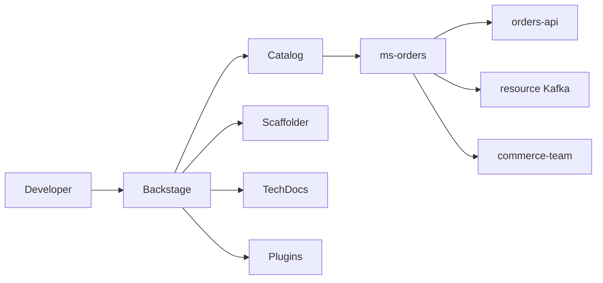

# Doce horas, y si solo te quedan dos

Versión: Backstage **1.55.3** estable al 7 de octubre de 2026. No uses `1.56.0-next` para preparar la entrevista.
Empieza el curso largo por `00-roadmap.md`. Este fichero es lo que tienes que poder decir.

## La frase

Backstage es el framework del developer portal de ACME. El catálogo dice qué existe y de quién es. El Scaffolder crea el siguiente NestJS. TechDocs enseña el servicio al lado de la ficha. Los plugins enlazan GitHub, Kubernetes y Grafana. El portal no despliega y no está en el camino de una compra.

## Mapa mínimo

Auth vive en otro system (`identity-platform`) aunque orders lo llame. Llamar es `consumesApis`. Pertenecer es `spec.system`.

## Kinds

| Kind | ACME | Obligatorio en spec |
| --- | --- | --- |
| Component | ms-auth, ms-orders, ms-payments | type, lifecycle, owner |
| API | auth, orders, payments, OpenAPI | type, lifecycle, owner, definition |
| Resource | Postgres, Redis, Kafka | type, owner |
| System | identity-platform, commerce-platform | owner |
| Domain | commerce | owner |
| Group | platform, commerce, payments | type, children |
| User | ana, leo, guest del catálogo | — |
| Template | nestjs-microservice | type, parameters, steps |
| Location | all.yaml | targets |

`apiVersion` de entidades: `backstage.io/v1alpha1`.
`apiVersion` del template: `scaffolder.backstage.io/v1beta3`.
Sintaxis del template: `${{ parameters.name }}` y, en el skeleton, `${{ values.name }}`.
La guía vieja con `backstage.io/v1beta2` y `{{ parameters.name }}` no es la que escribes.

## catalog-info de orders, de memoria

Owner `commerce-team`. System `commerce-platform`. Provee `orders-api`. Consume `auth-api` y `payments-api`. Depende de Postgres, Kafka, `ms-auth` y `ms-payments`. Anotaciones: slug de GitHub, `techdocs-ref: dir:.`, `kubernetes-id`.

Kafka lo posee `platform-team`. Un solo owner. El owner no es un permiso.

## Golden path

1. Create → NestJS Microservice, dueño platform-team.
2. Name, description, owner, repo.
3. `fetch:template` rellena el skeleton.
4. `github:repo:create` y `github:repo:push`. En 1.55 los inputs de protección de rama y de autor van en el push, no en el create.
5. `catalog:register`.
6. Actions hace install, build, test, `docker build`. No hay deploy.
7. El dominio hexagonal lo escribe el equipo. El skeleton trae health, Dockerfile no root, test y el descriptor.

Token de GitHub en el backend: `${GITHUB_TOKEN}`. No en React. No es el login de la persona.

`${{ github.sha }}` dentro del workflow se escapa como `${{ '${{ github.sha }}' }}`.

## Campo y acción propios

En el portal 1.56, frontend nuevo:

- El campo `AcmeServiceName` es un `createFrontendModule` del plugin `scaffolder`. El template pone `ui:field: AcmeServiceName`.
- La acción `acme:service:stamp` es un backend module. `createTemplateAction` y `scaffolder.addActions`.
- El template `acme-service-stamp` usa los dos y escribe `acme.yaml`. No necesita token. Dry run si `supportsDryRun` está en true.

El frontend clásico registra el campo de otra forma. Di cuál usa tu `App.tsx`.

## Plugin

UI → `discoveryApi` + `fetchApi` → `/api/service-health/services` → backend → `http://127.0.0.1:4010`.
Si el mock cae, 502. Curl sin token, 401. La URL vive en config con schema. El frontend no la conoce.
`createBackendPlugin` y `backend.add`. Un module sería una extensión del catálogo, no esto.
Dos frontends: clásico en `App.tsx`, nuevo con `PageBlueprint`. Di cuál usaste.

## Producción, la lista corta

- Un portal, no uno por equipo.
- Postgres, no SQLite, si hay más de un proceso.
- Sin guest. IdP y sign-in resolver al User del catálogo.
- Policy en el backend. El owner no autoriza solo. En 1.55 el dry run tiene permiso propio.
- Secretos `${ENV}`. Nunca en una anotación. El token de Kubernetes no va en el catálogo.
- TechDocs generados en CI. `builder: local` solo en la laptop.
- Imagen del portal distinta de la imagen de `ms-orders`. Tag con el sha.
- Kubernetes: label `backstage.io/kubernetes-id` en el pod y la misma anotación en la entidad. El plugin lista. No despliega.
- Grafana se enlaza. Prometheus no se sustituye.
- El portal caído no tumba la tienda.

## Lo que no debes decir

- "Backstage orquesta los microservicios."
- "El Domain de Backstage es mi bounded context."
- "SQLite en el Deployment con dos replicas."
- "El frontend llama a la API interna con el token."
- "Create despliega a producción."

## Si el tiempo no da

1. Instalar y abrir http://localhost:3000 (`02-installation/02-installation.md`).
2. Cargar `all.yaml` y abrir `ms-orders` (`03-software-catalog`).
3. Abrir el template y explicar los cuatro steps (`05-software-templates`).
4. Si la entrevista pide extensiones: campo `AcmeServiceName`, acción `acme:service:stamp` y el template que los junta (capítulos 07, 08 y 09).

El plugin, si hay una hora más. La defensa de cinco minutos está en `11-final-project/interview-defense.md`.
La simulación está en `backstage-interview.md`.
