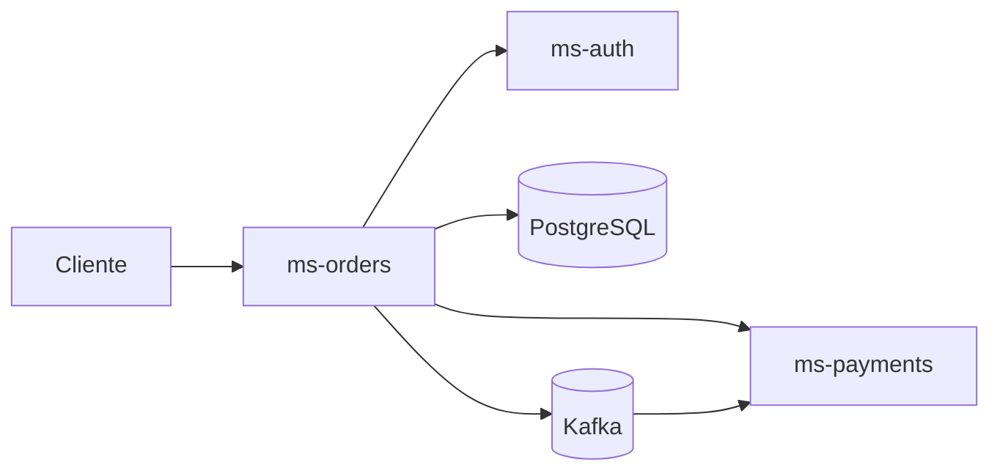

# Arquitectura

`ms-orders` es un servicio NestJS. El catálogo de Backstage no reemplaza el código: lo describe.

## Dentro del servicio

El código real, cuando exista, sigue la arquitectura que ya conoces:

- `domain/`: pedido, estados, reglas
- `application/`: crear pedido, consultar pedido
- `infrastructure/`: TypeORM o el cliente de Postgres, productor Kafka, cliente HTTP de payments
- `interfaces/`: controller HTTP

Backstage no impone esa estructura. El template del golden path solo deja el esqueleto para que todos los equipos empiecen igual.

## Relaciones en el catálogo

| Campo en catalog-info.yaml | Relación que genera |
| --- | --- |
| `spec.owner: commerce-team` | ownedBy |
| `spec.system: commerce-platform` | partOf |
| `spec.providesApis: [orders-api]` | providesApi |
| `spec.consumesApis` | consumesApi |
| `spec.dependsOn` | dependsOn |
